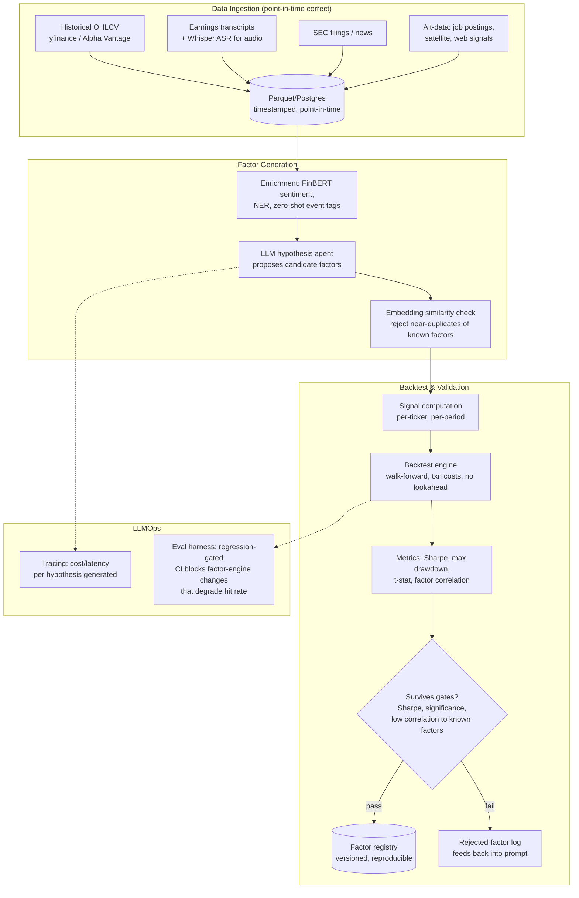

# AlphaWeave 🧵📈

**An LLM-driven factor-research platform that generates trading-signal hypotheses from unstructured financial data and proves (or kills) them with rigorous, statistically-validated backtests.**

> Portfolio project spec for a mid-level SWE (2–6 YOE) pivoting into quant research / quant development. Designed to be shipped solo in 8–12 weeks. The differentiator: every factor this system proposes is backed by a historical simulation with a Sharpe ratio, a drawdown, and a t-stat — not a paragraph of LLM-generated prose.

---

## 1. The Problem (and why this project stands out)

Quant researchers spend most of their time on a narrow, expensive loop: read something (a transcript, a filing, a research note), form a hypothesis ("companies that mention supply-chain risk more often underperform next quarter"), turn it into a computable signal, and backtest it. Most hypotheses fail. The bottleneck isn't compute — it's **generating enough good hypotheses to test**, because a human can only read so much.

**AlphaWeave** automates the hypothesis-generation step with an LLM that reads earnings transcripts, filings, and alternative data, and proposes candidate factors — but treats every proposal as *unproven* until it survives a real backtest against 10+ years of price history. The system's output isn't an answer; it's a **ranked, falsifiable claim**: *"this factor would have produced a 1.3 Sharpe with a 12% max drawdown from 2015–2025, and it isn't just re-discovering momentum (correlation 0.09)."*

Why this beats the usual "LLM + finance" portfolio project:

- **It's not a chatbot.** There's no "ask a question, get an answer" surface. The product is a pipeline that manufactures and falsifies hypotheses at scale — the actual job of a quant researcher.
- **Ground truth is objective.** A factor either would have made money or it wouldn't. This makes the eval harness deterministic and defensible in a way sentiment-only or QA-only projects can't match.
- **It forces you to learn real quant hygiene**: point-in-time data (no lookahead bias), transaction costs, walk-forward validation, multiple-testing correction. Getting these wrong is the single most common way "LLM finds alpha" projects collapse under interview scrutiny — building them in correctly is what makes this one hold up.

---

## 2. HuggingFace Tasks Integrated

| HF Task | Model (suggested) | Role in the system |
|---|---|---|
| **Text Classification** | `ProsusAI/finbert` | Sentence-level sentiment on transcripts/news — a raw input signal candidate (e.g., "sentiment momentum") |
| **Token Classification** | `dslim/bert-base-NER` (or finance-tuned variant) | Extract entities (executives, competitors, monetary amounts) from transcripts/filings to enrich factor context |
| **Automatic Speech Recognition** | `distil-whisper/distil-large-v3` | Transcribe earnings call audio when a text transcript isn't available |
| **Zero-Shot Classification** | `facebook/bart-large-mnli` | Tag news/filing events into categories (guidance change, litigation, M&A) without labeled training data — cheap event-factor candidates |
| **Feature Extraction / Sentence Similarity** | `BAAI/bge-m3` | Embed factor hypotheses to detect near-duplicates before wasting backtest compute on a factor that's just "momentum" restated |

Self-hosting FinBERT + the embedding model via **Text Embeddings Inference (TEI)** is a resume line on its own: *"served two HF models in production for real-time signal scoring."*

---

## 3. Architecture

### Design decisions worth defending in an interview

1. **Point-in-time data discipline.** Every signal is computed only from data that would have been *actually available* on that date — no using a full-year 10-K to trade in Q1. This is the single most common way naive backtests lie, and explicitly guarding against it is what separates a real quant project from a toy one.
2. **The dedup/correlation gate exists to prevent a trivial failure mode**: an LLM proposing "high sentiment predicts returns" in ten different phrasings and reporting ten "factors." Embedding similarity + correlation-to-known-factors filtering forces genuine novelty before a hypothesis earns backtest compute.
3. **Walk-forward validation, not a single in-sample backtest.** Split history into rolling train/test windows; a factor must hold up out-of-sample across multiple windows, not just look good on one lucky period.
4. **Transaction costs and realistic position sizing are modeled from day one** — a factor with a 2.0 Sharpe before costs and 0.3 after costs is a common and important negative result, not a bug to hide.
5. **Multiple-testing correction.** If you generate and test 200 factors, some will look significant by chance. Track how many hypotheses were tested and apply a false-discovery-rate correction (Benjamini–Hochberg) before calling anything real — the kind of statistical rigor a quant interviewer will specifically probe for.

---

## 4. Tech Stack

| Layer | Choice | Why |
|---|---|---|
| Language | **Python 3.11+** | Standard for quant research; pandas/numpy ecosystem |
| Data manipulation | **pandas, numpy** | Vectorized returns/metrics computation |
| Price data | **yfinance** (free) / Alpha Vantage (free tier) | Zero-cost, real historical OHLCV |
| Hypothesis generation | **Anthropic Claude API** | Structured-output factor proposals from unstructured text context |
| Sentiment / NER / zero-shot | **HF `transformers`** (FinBERT, NER, BART-MNLI) | Cheap, fast, self-hostable enrichment before the expensive LLM call |
| Agent orchestration (optional) | **LangGraph** | Propose → dedup-check → backtest → critic loop as a typed, bounded graph |
| Backtesting | **Hand-rolled vectorized engine** (pandas-based) | Full control and transparency over point-in-time correctness and cost modeling — a defensible, teachable choice over an opaque library |
| Storage | **Parquet files** (local) → Postgres for scale | Simple, versionable, no infra tax for a solo project |
| Evals / CI | **pytest** regression-gate harness | Blocks factor-engine changes that degrade backtest reliability |
| Observability | **Langfuse** (optional) | Cost/latency per hypothesis-generation call |

---

## 5. The Eval Harness

The core question an interviewer will ask: *"How do you know a factor is real and not luck?"* The harness answers it directly:

1. **Metrics unit tests** — `sharpe_ratio`, `max_drawdown`, `t_stat` computed against hand-verified known values (e.g., a synthetic return series with a known Sharpe). These must be exactly correct; they're the ground truth every downstream decision rests on.
2. **Walk-forward validation report** — for every factor, out-of-sample Sharpe across N rolling windows, not just one backtest number.
3. **False-discovery control** — track total hypotheses tested; apply Benjamini–Hochberg correction; report the corrected significance alongside the raw one.
4. **Regression gate in CI** — if a change to the backtest engine or signal-computation code shifts a benchmark factor's Sharpe by more than a tolerance on a frozen historical dataset, the PR fails. This catches silent lookahead-bias bugs, which are the most dangerous class of error in this domain.
5. **Rejected-factor log** — every hypothesis that fails gating is logged with its reason (low Sharpe, high correlation to known factor, failed out-of-sample). This log is itself a portfolio artifact: it shows the *process*, not just the survivors.

---

## 6. 8–12 Week Solo Roadmap

| Weeks | Milestone | Cut line |
|---|---|---|
| 1–2 | Point-in-time price + transcript ingestion for 20–30 tickers; `metrics.py` fully implemented and tested | Metrics correctness is non-negotiable — ship this first |
| 3–4 | Backtest engine v1: walk-forward splits, transaction costs, single hand-written factor (e.g., simple sentiment momentum) running end-to-end | Prove the pipeline before automating hypothesis generation |
| 5–6 | LLM hypothesis-generation agent; embedding-based dedup gate; run 20–30 generated factors through the engine | This is where the "AI" part becomes real |
| 7–8 | Multiple-testing correction; rejected-factor log; eval harness in CI with regression gates | The rigor layer — this is what a quant reads closely |
| 9–10 | Alt-data source (pick one: job postings or a free satellite/web dataset); expand ticker universe to 50–100 | One alt-data source is plenty; don't chase three |
| 11–12 | Report/dashboard (equity curves, factor correlation matrix); README + eval-log writeup; demo walkthrough | The writeup and the rejected-factor log *are* the portfolio |

**Scope discipline:** a single correctly-implemented factor backtested with real rigor (weeks 1–4) is worth more in an interview than ten factors backtested sloppily. Don't automate hypothesis generation until the manual pipeline is trustworthy.

---

## 7. Mapping to Real 2026 Quant JDs

| JD requirement (verbatim from real postings) | Where AlphaWeave proves it |
|---|---|
| "Design and backtest systematic trading signals" | Full walk-forward backtest engine with cost modeling, built from scratch |
| "Statistical rigor / hypothesis testing" | t-stats, multiple-testing correction (Benjamini–Hochberg), out-of-sample validation |
| "Alternative data integration" | Pluggable alt-data ingestion (job postings, satellite, transcripts) |
| "NLP / LLMs applied to financial text" | FinBERT sentiment, NER entity extraction, LLM hypothesis generation |
| "Python for quantitative research" | pandas/numpy vectorized engine, reproducible factor registry |
| "Avoiding lookahead bias / robust research process" | Point-in-time data discipline is a first-class architectural constraint, not an afterthought |
| "Communicate research findings" | Rejected-factor log + eval-log doc as a transparent research narrative |

---

## 8. Resume-Ready Impact Bullets (templates — fill with *your measured* numbers)

- Built an LLM-driven factor-research pipeline that generated and backtested **N** candidate trading signals across **T** tickers and **Y** years of history, with **K** surviving statistical significance after false-discovery correction.
- Designed a walk-forward backtest engine with transaction-cost modeling and point-in-time data guarantees; caught **Z** lookahead-bias bugs during development via a frozen-dataset regression gate.
- Reduced redundant factor proposals by **X%** using embedding-based similarity deduplication before committing backtest compute.
- Applied Benjamini–Hochberg correction across **N** tested hypotheses, distinguishing **K** statistically robust factors from **N-K** that were consistent with chance.
- Top-quartile generated factors averaged **X** out-of-sample Sharpe over **Y**-year walk-forward validation (state your real, measured number — a modest honest number beats an inflated one under interview questioning).

## 9. Portfolio Presentation

- **README with the architecture diagram and design-decisions section** (this file) — written for a quant reader who will probe point-in-time correctness and statistical rigor first.
- **`docs/eval-log.md`** — every factor tried, its stats, and why it was kept or rejected. This is the single most differentiating artifact for a quant audience: it shows *process discipline*, not just cherry-picked winners.
- **Equity curve + factor correlation matrix plots** for the surviving factors.
- **A short writeup** on the lookahead-bias bugs you caught and fixed — quants respect people who can describe how they *avoided* fooling themselves more than people who only report clean wins.

---

## Appendix: Relationship to EarningsLens

AlphaWeave shares its data domain (earnings calls, filings, financial text) with the sibling project **EarningsLens** (a citation-grounded RAG research assistant, aimed at AI-engineering roles rather than quant roles). Both can reuse the same transcript/filing ingestion layer — but the products diverge sharply: EarningsLens outputs a cited natural-language answer, AlphaWeave outputs a backtested, statistically-validated signal. Building both demonstrates that the same raw data can serve either an AI-engineering-flavored or a quant-flavored product surface, depending on what's asked of the LLM.
